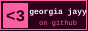

<div align="center">


<sub>✦ welcome 2 my lil corner of github !! ✦ under construction ~ forever ✦</sub>

**[projects](#-projects)** · **[now looping](#-now-looping)** · **[moots](#-moots)** · **[changelog](#-changelog)** · **[my button](#-my-button)**

</div>

---

### ♥ hiya vizitor!!

hello and welcome 2 my github !! i'm **Georgia Jayy**, i make **THING YOU MAKE** and this is where my code lives (and occasionally dies). poke around, open an issue, star whatever u like. a lot of these repos are half-finished so pls bear with me while i fight off procrastination !!

currently: **learning RUST / building a THING / breaking prod** 🛠️

---

### ♥ projects

<table>
  <tr>
    <td align="center" width="25%">
      <a href="https://github.com/georgiajayy/project-one"><br><b>project-one</b></a><br><sub>one-line description</sub>
    </td>
    <td align="center" width="25%">
      <a href="https://github.com/georgiajayy/project-two"><br><b>project-two</b></a><br><sub>one-line description</sub>
    </td>
    <td align="center" width="25%">
      <a href="https://github.com/georgiajayy/project-three"><br><b>project-three</b></a><br><sub>one-line description</sub>
    </td>
    <td align="center" width="25%">
      <br><b>???</b><br><sub>stay tuned !!</sub>
    </td>
  </tr>
</table>

---

### ♥ now looping

<table>
  <tr>
    <td></td>
    <td>
      <b>ALBUM TITLE</b><br>
      ARTIST<br>
      <sub>genre / genre</sub><br><br>
      <b>fav song/s:</b> SONG, SONG
    </td>
  </tr>
</table>

---

### ♥ moots

<!-- swap these for your friends' 88x31 buttons + links -->
<a href="https://github.com/FRIEND1"></a>
<a href="https://github.com/FRIEND2"></a>
<a href="https://github.com/FRIEND3"></a>

### ♥ made with


---

### ♥ changelog

- **14/10/2026** – readme genesis !!
- **DD/MM/YYYY** – shipped PROJECT
- **DD/MM/YYYY** – started learning THING

---

### ♥ my button



link me 2 ur site / readme !!

```html
<a href="https://github.com/georgiajayy"></a>
```

---

<div align="center">

✉ **[sign my guestbook!!](https://github.com/georgiajayy/georgiajayy/discussions)** ✉

<sub>design + code by me · inspired by the indie web ♥</sub>

</div>
